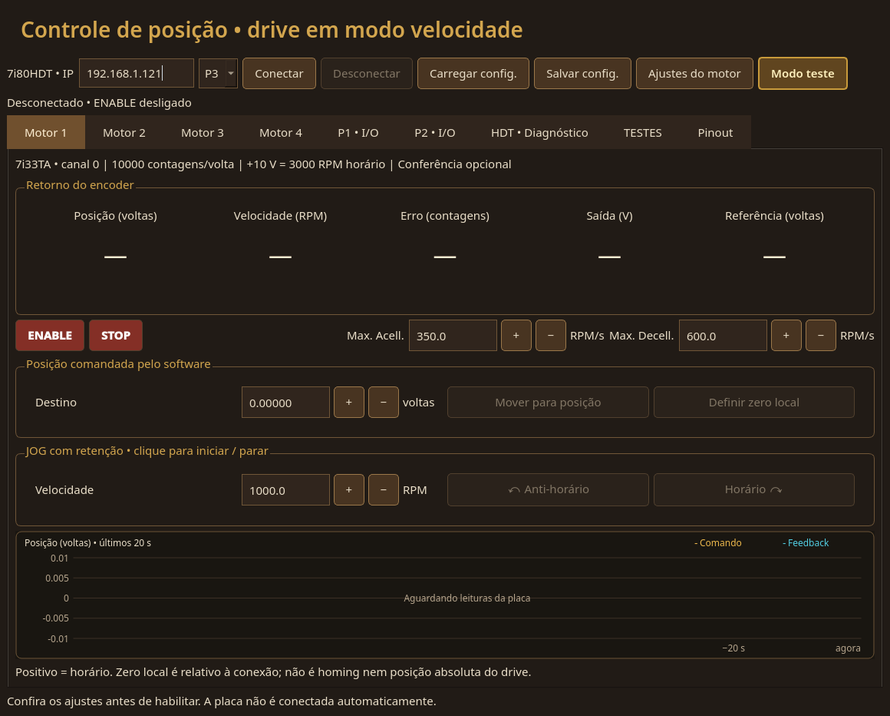

# T3D — 7i80HDT + 7i33TA, controle de posição pelo software

> **DRIVER ETHERNET PRÓPRIO — USE A PLACA MESA SEM LINUXCNC OU HAL.**
>
> Comunicação direta com a Mesa 7i80HDT, sem instalar ou executar LinuxCNC.

**Versão 0.2.7** — consulte [DESCRICAO.md](DESCRICAO.md) para a apresentação
do projeto e o estado desta versão.



Captura da interface 0.2.7 sem conexão à placa.
Mais imagens em [screenshots/](screenshots/).

Projeto independente: **LAN → 7i80HDT P3 → 7i33TA → T3D em velocity mode**.
O aplicativo original permanece na pasta superior. Esta cópia contém apenas
interface Qt, driver Ethernet, controlador de posição, configuração, testes e
manuais pertinentes. Não depende do projeto superior para compilar ou executar.

## Abrir

Execute `./iniciar.sh` nesta pasta. O iniciador compila e abre `build/v0.2.7/t3d_analog`.
Desde a 0.2.6, o auxiliar de clock pertence à interface e é separado do auxiliar de
permissões FIFO/memória do driver. Binários e auxiliares têm caminhos próprios
por versão para preservar os builds anteriores durante os testes.
Requisitos: Linux, CMake ≥3.21, compilador C++20, Qt6 Widgets ≥6.4 e Python ≥3.10.
Para ativar FIFO e bloqueio de memória, consulte a instalação opcional em
[TEMPORIZACAO.md](TEMPORIZACAO.md).
A compilação requer Cython ≥3.2 e os cabeçalhos do Python utilizado.
No Fedora: `sudo dnf install python3-cython python3-devel`.
Os módulos compilados usam a API do CPython e a biblioteca padrão; Cython é
uma ferramenta de compilação, sem serviço adicional durante a execução. Não requer LinuxCNC, HAL ou Qt SerialPort.
O projeto inclui um driver Ethernet próprio, que se comunica diretamente com
a Mesa 7i80HDT e permite usar a placa sem instalar ou executar LinuxCNC.

A tela tem quatro motores ligados à **mesma placa**, com uma única sessão de
controle. Conectar identifica o firmware e configura saídas em zero, desabilitadas.
Nenhum motor é habilitado automaticamente. Ajustes do motor podem ser aplicados com a placa conectada.
Carregar/Salvar configuração permite reutilizar a calibração de cada canal.

P1 e P2 ficam reservados para I/O genérico: em cada conector, os primeiros 12 sinais são
entradas e os últimos 12 são saídas push-pull, inicialmente em nível baixo.
As funções secundárias, inversão e open-drain de P1/P2 são desligadas. O valor das
saídas é zerado antes de habilitar sua direção. Ao desconectar ou encerrar por
falha, as saídas são zeradas e P1/P2 voltam a entradas; perda da rede depende do
watchdog para retirar a direção de saída. As abas **P1 • I/O** e **P2 • I/O**
mostram as 12 entradas e permitem ligar/desligar as 12 saídas de cada porta.
Não há uso de RDY/ALM nesta versão.

Os indicadores de entrada mostram níveis elétricos, não estado de motor. As
saídas mostram o comando reconhecido pela HDT, sem confirmação do equipamento
externo. A leitura dos I/Os usa o mesmo pacote dos encoders, e suas saídas são
escritas no mesmo pacote dos comandos analógicos e watchdog. Não há acionamento
automático ou restauração de saídas ligadas ao reconectar. Desconectar também
zera os comandos genéricos. Sem conexão, os indicadores mostram “—”.
O diagnóstico de movimento utiliza o encoder. Uma única 7i33TA está em P3,
para quatro motores. Configurações antigas são migradas para P3 pela interface,
retirando a marca de calibração conferida; conferir a ligação antes de ENABLE.
O backend rejeita configurações de servo em P1/P2.

Cada conector da 7i80HDT tem 50 pinos físicos: 24 sinais de I/O, um POWER e 25
terras. A divisão usa a numeração física do conector:

- Entradas por conector: pinos 1, 3, 5, 7, 9, 11, 13, 15, 17, 19, 21, 23.
- Saídas por conector: pinos 25, 27, 29, 31, 33, 35, 37, 39, 41, 43, 45, 47.
- Em P1: entradas IO0–IO11; saídas IO12–IO23.
- Em P2: entradas IO24–IO35; saídas IO36–IO47.
- POWER: pino 49; terras: todos os pares, de 2 a 50.

A numeração nos bornes de uma breakout pode ser diferente; conferir seu esquema.
Entradas/saídas de 24 V exigem interface elétrica adequada.

Sem RDY/ALM, o cabo CN1 de cada drive usa 12 condutores mais blindagem: analógico
26/10/11, encoder A/B/Z e GND 13/28/14/29/15/30/12, SON/COM+ 16/31.
CCWL/CWL, reset de alarme e freio não entram nessa contagem; conferir a configuração
e as necessidades da máquina antes de montar o cabo.

## HDT • Diagnóstico

A aba reúne as leituras da sessão normal ao conectar: modelo físico, IP,
identificação IDROM, geometria de I/O, módulos HostMot2 (versão, instâncias,
endereço e clock), canais dos encoders, frequência PDM e prazo do watchdog.
Durante a conexão mostra contadores brutos de 16 bits, posição calculada,
tensão e ENABLE comandados, ciclo atual, maior intervalo entre ciclos e
quantidade de ciclos concluídos. O contador bruto pode dar a volta em 65536;
a posição usa a acumulação feita pelo controlador.

Watchdog e quadratura só aparecem confirmados após um ciclo com leitura e
escrita reconhecidas pela HDT. Leituras atrasadas ou desconexão retiram os
valores atuais; a última identificação fica marcada como histórica.
O histórico mantém até 200 linhas de conexão, falhas e comandos rejeitados,
apenas durante a abertura atual do aplicativo.

A aba não abre outra conexão nem acrescenta comandos à placa. Usa a conexão
normal, que configura P3 e os GPIO de P1/P2 como descrito acima. Não mede tensão
analógica, fontes da 7i33TA ou estado SON do drive. Contagens paradas não
comprovam conexão do encoder. O nome do arquivo de firmware gravado não é
inferido do IDROM; consulte o registro em `firmware/registro-2026-10-11/`.

### Diagnóstico após falha

Com a interface presente, uma falha de execução interrompe o controle, solicita
saídas zeradas e ENABLE retirado, e mantém o mesmo processo proprietário da HDT.
O aplicativo preserva a causa no histórico e continua lendo contadores brutos,
erros de quadratura, níveis GPIO, máscara ENABLE e estado do watchdog a cada
100 ms. Essas leituras não gravam registradores, não limpam erros, não
reconfiguram a placa e não alimentam o watchdog. É normal vê-lo expirado nesse
estado. A posição acumulada e a tensão do controlador deixam de ser valores
atuais e aparecem como “—”.

Se a rede falhar, a aba informa ausência de resposta e tenta novamente somente
leituras. Quando a placa volta a responder, as leituras reaparecem sem reativar
saídas. Um desligamento sem confirmação também fica registrado. Para retomar o
controle, clique em **ENABLE**: o aplicativo reinicializa e valida a sessão da
HDT, mantendo a referência local, e habilita somente o motor escolhido. Não há
retomada automática do JOG, nem restauração das saídas genéricas. O modo teste
e a aceleração podem ser ajustados antes desse rearme. Se a placa não responder
ou a validação falhar, permanece em diagnóstico e registra a rejeição. Perda do heartbeat/fechamento da
interface encerra o processo; falhas durante a conexão inicial continuam
impedindo iniciar o controle.

## Editar a interface no Qt Designer

Abra **Editar interface.desktop** nesta pasta, ou execute `./editar-interface.sh`.
O Qt Designer 6.11.2 está instalado localmente em `.tools/qt-designer/`, com
bibliotecas da mesma versão do Qt deste sistema, obtidas dos repositórios Fedora.
Não é necessário instalar LinuxCNC nem usar senha de administrador para abrir.

Essa instalação do editor e os atalhos `.desktop` são locais e não acompanham
o repositório. Em outra máquina, instale o Qt Designer 6 da distribuição;
`./editar-interface.sh` também procura o editor nos caminhos usuais do sistema.

- `app/mainwindow.ui`: aparência, textos, cores, tamanhos, alinhamento e layout
  das abas dos motores, I/O e diagnóstico.
- `app/axissettingsdialog.ui`: janela de ajustes do motor.
- `app/interface.cpp`: liga os controles visuais às ações do aplicativo.
- `app/mainwindow.cpp`: configuração, comunicação com o backend e atualização
  de estados; não constrói mais o layout das janelas.
- `driver/`: driver Ethernet, controlador e processo de comunicação, separados
  da interface.

Edite os arquivos `.ui` no Designer e salve. Preserve os nomes dos objetos
(`objectName`), pois o código usa esses nomes para ligar botões e campos.
As cores de estado, os valores lidos e a disponibilidade dos comandos continuam
sendo atualizados pelo aplicativo. Não edite os cabeçalhos `ui_*.h` em `build/`:
são gerados automaticamente. Feche e abra **Iniciar T3D** para recompilar e aplicar
suas alterações. O Designer somente edita a interface; não conecta à placa.

## Valores iniciais

| Campo | Valor |
|---|---|
| Endereço Ethernet | 192.168.1.121, editável; não altera o IP gravado na placa |
| Conector da 7i80HDT | P3 → J1 da 7i33TA |
| Escala de velocidade | +10 V = 3000 RPM horário; −10 V = 3000 RPM anti-horário, informados pelo operador |
| Encoder | 10.000 contagens/volta, derivadas do padrão P-172=2500 linhas ×4 |
| Referência de posição | Voltas do motor; positivo = horário |
| Limite inicial de velocidade | 1000 RPM; JOG começa em 1000 RPM |
| Aceleração da trajetória | 350 RPM/s |
| Desaceleração / STOP | 600 RPM/s, ajustável separadamente |
| Faixa de saída analógica | Fixa em ±10 V; velocidade limitada pelo ajuste de RPM |
| PID inicial | P=50 s⁻¹, I=0, D=0; FF1=1 |
| Erro de seguimento | 0,1 volta entre referência da trajetória e encoder |
| Coincidência de posição | Erro ≤2 contagens, baixa velocidade e estabilidade por 100 ms |
| Limites locais iniciais | −10 a +10 voltas; ajustar à mecânica |

Esses ganhos e limites são valores de partida para bancada, **não uma sintonia
validada no motor real**. O limite de saída corresponde ao teto de RPM
convertido em tensão, dentro da faixa física de ±10 V. Com 60 RPM e 300 RPM/V, resulta em ±0,2 V.
O PDM de 12 bits quantiza a tensão em aproximadamente 2,44 mV; ganho e tolerância
devem ser ajustados considerando essa resolução e o comportamento do drive.

P-172 define pulsos equivalentes na interface, não a resolução física do encoder
absoluto. Os 10.000 counts/rev são um padrão inicial, condicionado ao P-172 real e
à saída configurada para feedback. P-184 não é usado para deduzir essa escala.
Os sentidos de saída e encoder são ajustáveis separadamente. A 7i80HDT não lê
esses parâmetros do T3D pela conexão analógica.

## Preparação do drive e feedback

No T3D, conferir pelo painel/comissionamento:

- **P-004=1**: velocidade; **P-025=0**: referência analógica.
- **P-179=0**: saída de pulsos do encoder real, não sincronizada ao comando.
- **P-172=2500**, se forem usados os 10.000 counts/rev iniciais.
- Escala analógica e sentido correspondentes a ±3000 RPM a ±10 V.
- Encaminhar os sinais incrementais A/B (e índice quando disponível) de feedback
  à 7i33TA e selecionar seus jumpers TTL/RS-422 conforme a interface física.

Não ligar o encoder serial absoluto CN2 D+/D− às entradas de quadratura: elas
precisam de sinais incrementais compatíveis. A conexão do feedback deve permitir
observar a posição mesmo sem movimento comandado pelo software.

A saída ENA da 7i33TA é de **5 V ativo alto**; a interface DI do T3D desenhada no
manual de comissionamento utiliza COM+ de **12–24 V**. A ligação SON precisa de
interface elétrica compatível; o aplicativo não demonstra compatibilidade direta.
A alimentação, referência analógica, proteção de limites e intertravamento do
drive devem ser montados conforme os manuais. Sem um retorno de SON/alarme
cabeado, a tela informa o comando de ENABLE da Mesa, não uma confirmação do T3D.

O programa não grava parâmetros, EEPROM ou P-184/P-024/P-036. A opção
“Conferi…” nos ajustes registra que modo, escala, sentidos, limites e ligação foram
conferidos para aquele motor, apenas como registro opcional. Essa marca não bloqueia ENABLE, JOG ou movimento.

## Operação

1. Confira ajustes e ligação. Conecte: leituras aparecem, saídas ficam desabilitadas.
2. Girando o motor sem comando, confira counts/rev e sentido do feedback.
3. Com motor parado, **Definir zero local** muda somente a referência do software.
4. **ENABLE** começa com velocidade zero por 100 ms e passa a manter a posição
   presente. Aguarde a indicação “Na posição”.
5. Informe o destino em voltas e use **Mover para posição**. O software gera
   trajetória triangular/trapezoidal, mede o encoder e comanda velocidade até
   atingir e manter a posição. Um novo destino exige movimento anterior concluído.
6. JOG tem retenção: um clique inicia; outro clique no mesmo sentido desacelera
   e mantém a posição final. Clicar no sentido oposto inverte com a rampa definida.
   Perda de foco não cancela o comando; STOP para o movimento, e clicar em ENABLE
   retira a habilitação daquele motor. Fora do teste de saída, JOG mantém a malha de posição.
7. **STOP** na aba do motor desacelera a trajetória com **Max. Decell.** e
   mantém ENABLE e retenção da posição final. **ENABLE** é um botão de alternância:
   verde indica comando ligado; vermelho indica desligado. Clicar novamente retira
   ENABLE e zera a saída daquele motor. Desconectar/fechar solicita esse
   desligamento para todos os motores e saídas genéricas.

Para medir a saída sem motor/drive conectado, selecione **Teste de saída sem
encoder** no topo, para o motor selecionado. Pode ser alternado com ENABLE ligado. Nesse modo, JOG comanda
velocidade diretamente, sem correção PID nem falha por ausência de resposta do
encoder. A posição virtual integra a velocidade efetivamente comandada pela
rampa. Posição e RPM exibidos são virtuais, identificados por “MODO TESTE” em
amarelo; o erro é posição virtual menos posição real, convertido em contagens.
A leitura real do encoder continua ativa: girar o eixo à mão altera o erro.
Posição e RPM reais também aparecem ao passar o mouse sobre os campos.
A simulação segue os limites da saída; não pretende modelar a dinâmica do drive. RPM é a velocidade comandada pela escala analógica, não uma medida.
Por exemplo, 10 RPM com 3000 RPM a 10 V corresponde a aproximadamente 0,033 V,
com quantização PDM; o limite padrão de 3000 RPM permite até ±10 V.
STOP desacelera a saída até zero e mantém ENABLE; clicar em ENABLE retira a
habilitação. Watchdog, limite de velocidade e verificações de comunicação
continuam ativos. Movimento para posição também funciona no modo teste: a trajetória comanda a
saída e move a posição virtual até o destino, sem correção pelo erro real.
A seleção do teste é temporária e é desfeita ao desconectar. Alternar o modo
não zera o encoder nem a posição virtual acumulada. Ao sair do teste, os campos
mostram novamente o encoder real; a posição virtual fica preservada para a
próxima ativação. JOG continua com ENABLE ligado. Um movimento para posição
em andamento é interrompido com desaceleração na troca, e a referência normal é ancorada na posição
real para evitar tentar alcançar uma posição simulada.

O campo JOG aceita de 0,1 até 9999,9 RPM. Durante JOG com retenção, editar
o RPM aplica o novo valor após 250 ms sem alteração, ou imediatamente ao
confirmar o campo. A saída segue a rampa Max. Acell.; a mensagem inferior
confirma o RPM ou informa quando os ajustes de velocidade o limitam. No teste, a saída satura nos limites
configurados; no controle normal, comandos acima do limite de velocidade são
rejeitados.

Destino, RPM e **Max. Acell.** têm botões `[+][−]` lado a lado e unidades
à direita, fora do campo. Pode ser alterada durante JOG, frenagem ou movimento de posição; neste último,
a trajetória é recalculada a partir da referência e velocidade atuais. Reduzir
muito a aceleração durante a frenagem pode exigir passar do destino e retornar;
a alteração é rejeitada se essa trajetória ultrapassar os limites de posição.
O valor aceito fica na configuração da interface e pode ser salvo para reutilizar.

O zero é relativo à conexão e é perdido ao reconectar. Não há homing automático,
recuperação de posição absoluta, leitura Modbus de alarmes ou controle de freio.
“Na posição” é calculado pelo software; não é a saída COIN do drive.

### Comando sem resposta do encoder

Durante JOG, movimentos de posição e correções fora da tolerância, o software
verifica se o encoder avança no sentido do comando de velocidade efetivamente
enviado. Sem progresso de pelo menos duas contagens por **0,5 s** e com pelo menos
quatro contagens de deslocamento esperado, gera “Comando de movimento sem
resposta do encoder”. O prazo é editável por motor em **Ajustes do motor**
(`no_response_timeout_s`, 0,05–10 s); configurações antigas usam 0,5 s.

A falha identifica o motor, solicita saídas em zero e retira ENABLE de todos os
motores, mantendo a sessão em diagnóstico somente leitura. É preciso corrigir
a causa e usar ENABLE para rearmar o controle. A espera de 100 ms após
ENABLE permanece. Motor parado sem demanda de movimento, correções dentro da
tolerância e tensões abaixo de meio passo do PDM não disparam essa proteção.
Em velocidades muito baixas, o prazo pode aumentar até acumular quatro contagens
esperadas. Mudança do sentido reinicia a janela; o erro máximo de seguimento
continua ativo, inclusive para movimento em sentido errado.

Essa verificação detecta falta de resposta mecânica medida, sem distinguir motor
travado, SON não acionado ou encoder desconectado. Não confirma RDY/ALM e não
substitui intertravamentos físicos. Os valores iniciais exigem validação na bancada.

## Separação entre driver e controlador

- `driver/mesa7i80hdt.py`: LBP16/UDP, descoberta HostMot2/IDROM, configuração GPIO,
  PWM/PDM, watchdog, leitura de contagens e escrita de volts/ENABLE. **Não recebe
  alvos de posição e não executa PID.**
- `driver/servo.py`: acumulação dos contadores de 16 bits, escala, zero local,
  trajetória, PID com FF1, saturação e proteção de erro/limites.
- `driver/backend.py`: processo proprietário da placa; executa leitura → controle
  → escrita reconhecida dos quatro canais e comunica estados com a interface.
- `app/`: interface C++/Qt, sem comunicação RS-485 ou transporte serial.

O controlador calcula, em voltas e segundos:

```text
erro = referência_da_trajetória − posição_do_encoder
velocidade = P·erro + I·integral(erro) + D·(vel_ref − vel_medida) + FF1·vel_ref
volts = velocidade_em_voltas/s × 600 / RPM_a_10V
```

Há deadband de 0,6 contagem, limite de saída e anti-windup por saturação. A
aceleração limita a **trajetória**, enquanto a correção PID mantém autoridade para
corrigir o seguimento. O drive continua fechando suas malhas internas de velocidade
e corrente. Não se envia alvo de posição ao T3D.

## Temporização da versão 0.2.7

A execução usa uma grade absoluta de 1 ms (1000 Hz), com diagnóstico da variação entre
ciclos e dos tempos de leitura, cálculo e escrita. O backend tenta prioridade
SCHED_FIFO, afinidade de CPU e bloqueio da memória atual, e informa no diagnóstico
o que o sistema permitiu. Ganhos PID e limites de falha permanecem os mesmos.
Consulte [TEMPORIZACAO.md](TEMPORIZACAO.md) para funcionamento, opções e comparação
com a referência real da 0.2.0. A malha é compilada em extensões C com Cython; ainda usa CPython/GIL e não garante tempo real rígido. Consulte [CYTHON.md](CYTHON.md).

## Firmware, ciclos e desligamento

O firmware precisa oferecer GPIO, PWMGen v0/v1, watchdog e quatro encoders
HostMot2 não multiplexados v2/v3, com o pinout da 7i33TA no conector selecionado.
O driver descobre endereços, instâncias e strides, valida A/B/índice e
PWM/DIR/enable **antes de qualquer escrita**, e rejeita firmware incompatível.
Nenhum bitstream é gravado por este aplicativo.

Pinagem esperada no J1 da 7i33TA, numeração física do flat de 50 vias:

| Canal | A | B | Índice | PWM | DIR | /ENA |
|---|---:|---:|---:|---:|---:|---:|
| 0 | 7 | 5 | 11 | 15 | 19 | 23 |
| 1 | 3 | 1 | 9 | 13 | 17 | 21 |
| 2 | 31 | 29 | 35 | 39 | 43 | 47 |
| 3 | 27 | 25 | 33 | 37 | 41 | 45 |

O processo solicita ciclo de **1 ms** e rejeita intervalos/processamento acima de
**20 ms**. Um heartbeat da interface deve chegar em até **500 ms**. Só o ciclo
que lê feedback e atualiza saídas alimenta o watchdog da Mesa de **100 ms**.
Timeout, erro de quadratura, salto impossível de contagem, erro de seguimento
ou limite excedido interrompem o controle e passam a sessão para diagnóstico.
Não há retomada automática. Perda da interface encerra o processo.
Ao perder o processo/rede, o watchdog deixa GPIO como entrada e os pull-ups de
/ENA da 7i33TA retiram sua habilitação; isso depende da ligação correta de SON.

Python e o escalonador comum do sistema **não garantem tempo real rígido**. O
comportamento sob carga, latência Ethernet e sintonia precisam ser medidos antes
do uso físico. O limite padrão é 1000 RPM, ajustável por motor.
O watchdog não substitui a parada de emergência elétrica.

A placa deve ter um único proprietário: não executar outro aplicativo, HAL ou
mesaflash fazendo escritas simultaneamente. Há trava local entre instâncias deste
backend, além da recusa de assumir uma placa com saídas PWM já habilitadas.

## Ajuste medido da rede dedicada à Mesa

Na Intel I219-LM (`enp0s31f6`, driver `e1000e`), a moderação de interrupções
RX foi desativada com `rx-usecs=0`, persistido no perfil Ethernet `lan-cnc` do
NetworkManager. O valor anterior, `3`, selecionava um modo dinâmico conservador;
não representava um atraso literal de 3 µs. A mudança foi aplicada sem derrubar
o link e sem alterar o Wi-Fi, os offloads, a BIOS ou o kernel nesse ensaio.

Comparação de 100 pings antes e 100 depois, em 11/10/2026:

| RTT | Antes | Depois |
|---|---:|---:|
| Médio | 0,327 ms | **0,144 ms** |
| P95 | 0,345 ms | **0,163 ms** |
| Máximo | 0,367 ms | **0,168 ms** |
| Perda de pacotes | 0/100 | 0/100 |

O RTT médio caiu aproximadamente **56%**. As interrupções da NIC aumentaram de
cerca de 1501 para 2015 por segundo. A carga total de CPU também variou, mas o
ensaio não isolou o custo do driver. O desvio informado pelo ping foi de 0,011
para 0,012 ms; a redução do RTT não demonstra, por si só, redução do jitter da
malha ou garantia de tempo real. O kernel deste ensaio não era PREEMPT_RT.

O ajuste recomendado pela documentação `hm2_eth` também se aplica à rede do
driver próprio T3D, sem instalar LinuxCNC. Consulte o
[relatório integral, com comandos, fontes e reversão](medicoes/2026-10-11-rede-i219-lm-RELATORIO.md).
O relatório foi copiado sem alterações; os arquivos brutos que ele menciona
permanecem na pasta de origem
`/home/dell7010/.local/state/network-tuning/i219-lm-20261011-oTQ5Tr/`.

## Validação sem placa

```sh
cmake -S . -B build/v0.2.7 -DCMAKE_BUILD_TYPE=Release
cmake --build build/v0.2.7 --parallel 4
ctest --test-dir build/v0.2.7 --output-on-failure
```

Os testes exercitam datagramas UDP contra FPGA simulada, pinagem, polaridade,
encoder/rollover, PID, trajetória e parada, planta de velocidade com atraso,
processo completo pela interface JSON, perda do cliente e morte do processo com
expiração do watchdog. Também há abertura/fechamento da interface Qt sem display.
Isso não é uma validação elétrica, mecânica ou de tempo real da placa real.

## Fontes

Os PDFs de referência, os pacotes de firmware baixados e as ferramentas
compiladas localmente não acompanham o repositório. Os links oficiais abaixo
e o registro em `firmware/registro-2026-10-11/` identificam as fontes utilizadas.

- Skill `motor-control`: manual **T3D 调试手册 V2.3**; cópia em
  `reference/T3D_Debugging_Manual_V2.3_CN.pdf`. P-004/P-025/P-172/P-179:
  PDF 17–20 / impressas 14–17; conexões CN1: PDF 6 / impressa 3.
- [LinuxCNC PID(9)](https://linuxcnc.org/docs/html/man/man9/pid.9.html):
  comando/feedback em posição, saída em velocidade, PID/FF1, deadband e
  anti-windup. A implementação aqui é própria e não carrega o componente HAL.
- [LinuxCNC HostMot2(9)](https://linuxcnc.org/docs/html/man/man9/hostmot2.9.html):
  encoder, escala, watchdog e PWM/PDM.
- [Mapa de registradores HostMot2](https://raw.githubusercontent.com/LinuxCNC/hostmot2-firmware/master/src/regmap)
  e [encoder.c](https://github.com/LinuxCNC/linuxcnc/blob/master/src/hal/drivers/mesa-hostmot2/encoder.c):
  contagem nos 16 bits baixos, timestamp nos altos; registros e versões suportadas.
- [Manual 7i80HDT](https://www.mesanet.com/pdf/parallel/7i80hdtman.pdf),
  cópia `reference/7i80hdtman.pdf`: Ethernet/LBP16 e portas P1/P2/P3.
- [Manual 7i33/7i33TA V1.9](https://www.mesanet.com/pdf/motion/7i33man.pdf),
  cópia `reference/7i33man.pdf`: impressas 5 (J1), 7–8 (TB1/TB2), 9–10
  (PDM/encoder/ENA e sinal analógico).

## Ajustes com a placa conectada

A janela **Ajustes do motor** permanece disponível durante a conexão, inclusive
no diagnóstico após falha. Ao confirmar, a configuração é validada e aplicada
ao motor na sessão atual. RPM, aceleração e ganhos podem ser alterados durante
o movimento; trajetórias de posição são recalculadas. Ajustes inválidos são
rejeitados sem substituir os valores aceitos anteriormente.

Alterar contagens por volta, sentido do encoder, sentido da saída ou escala
RPM a 10 V desabilita somente o motor afetado e cancela seu movimento. A
referência local é preservada; use ENABLE para retomar. Os demais motores e
a conexão permanecem ativos. **Salvar configuração** também funciona conectado.

## Gráfico de comando e feedback

Cada aba de motor tem, abaixo do JOG, um gráfico dos últimos 20 segundos.
A linha amarela mostra a posição comandada pela trajetória, e a linha azul
mostra a posição real do encoder, ambas em voltas. No modo teste, a linha
de comando acompanha a posição virtual; o feedback continua sendo real.
O histórico permanece ao alternar o modo e marca interrupções nas leituras.
Os botões **Ajustes do motor** e **Modo teste** ficam ao lado de **Salvar config.**
e acompanham a aba de motor selecionada.

## TESTES • Loopback

**Monitor de períodos e log:** abra pela aba TESTES ou pelo atalho próprio.
É um aplicativo C++ separado, fixado em outra CPU, que grava estatísticas
já medidas pelo controlador, sem acrescentar gravação em disco à malha.
Mostra estouros de trabalho, ciclos perdidos e tempos de leitura/controle/escrita.
Procedimento, arquivos e limites da medição em [MONITOR_PERIODOS.md](MONITOR_PERIODOS.md).

A aba **TESTES** mede 100 ciclos de saída ENA e retorno pela entrada A do
encoder, com tempos médios separados de ON/OFF, mínimo, máximo, P95 e desvio
padrão. Escolha o canal; o botão **?** abre a ligação e o procedimento completo.
Consulte [TESTE_LOOPBACK.md](TESTE_LOOPBACK.md) antes de montar o fio.

O ensaio usa o condicionador TTL da 7i33TA e a mesma conexão do controlador,
com saídas analógicas em zero. Mede o tempo observado pelo computador, incluindo
o ciclo de leitura, e não altera o PID automaticamente. Fio ausente, retorno
instável e falhas interrompem o teste; não há média válida com amostra incompleta.

Antes do loopback analógico, o campo **Teste manual PWM/PDM** permite aplicar
magnitude positiva de 0 a 100% e medir DRV com multímetro, sem conexão ao
encoder. Use **Zerar / desligar** para retirar ENABLE. A tensão exibida é
nominal calculada; o aplicativo não mede a tensão de DRV.

O seletor também oferece loopback analógico 0/+4 V, medindo o cruzamento do
limiar da entrada A. A entrada TTL não é especificada para a faixa ±10 V de
DRV: consulte as condições elétricas em TESTE_LOOPBACK.md antes da ligação.
O ensaio não mede diretamente a estabilização da tensão.

## Otimizações locais 0.2.5

Na 0.2.5 o período era 2 ms; a 0.2.6 foi atualizada para 1 ms a pedido do operador.
Temporizador absoluto, estatísticas com janela fixa
e planejamento de rampas assimétricas usam C++ em `native/`; o restante do backend
continua em extensões Cython. O gráfico e o protocolo de telemetria foram preservados.
Não há ganho de jitter declarado antes de uma nova medição física.

Ao abrir a interface, o helper instalado aplica o governador `performance`,
preferência de desempenho e restrição de repouso apenas à CPU dedicada (CPU 5
nesta máquina). Solicita limites mínimo/máximo de 4200 MHz quando o driver permite
selecionar essa frequência. O diagnóstico registra o que foi confirmado e a
configuração anterior é restaurada ao fechar, inclusive após queda da interface.
Detalhes e limitações em [OTIMIZACAO_0.2.5.md](OTIMIZACAO_0.2.5.md).

## Pinout

A aba **Pinout** exibe a fotografia da 7i33TA, centralizada horizontalmente,
com rolagem vertical para consultar toda a placa. A foto PNG com fundo transparente está incorporada
ao executável e não depende de um arquivo externo durante o uso.
